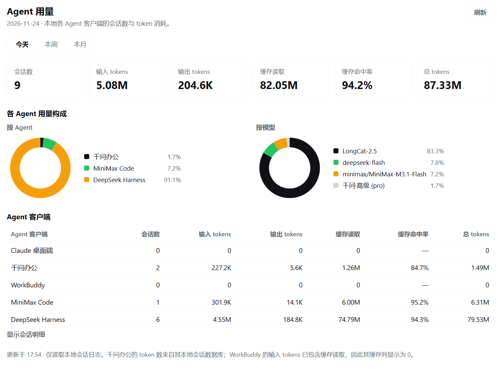

# Agent usage

A DeepSeek Harness bundle that adds a **left-sidebar panel** showing session
count and token consumption for the agent clients installed on this machine,
over the current day, week, or month.

## What it shows

- A time-range switch: **Today**, **This week** (Monday-based), **This month**.
- A responsive row of summary cards: sessions, input tokens, output tokens, cache
  reads, cache hit rate, and total tokens for the selected window.
- Two donut charts side by side: token share **by agent** and **by model**, each
  with a percentage legend.
- A per-client table: Claude desktop, Qwen Work, WorkBuddy, MiniMax Code, and
  DeepSeek Harness.
- A per-session detail table (toggleable) with the last-activity time and token
  breakdown of each session active in the window.

## Where to find it

Open the DeepSeek Harness Web GUI, then click the **Agent usage** icon in the
left sidebar's panel list (beside Plugins and Schedules). The panel appears in
the central column.

## Data sources and limits

- Claude desktop: `%LOCALAPPDATA%\Claude-3p` / `%APPDATA%\Claude-3p`
  (and the `Claude` equivalents) under their `projects` directories
- Qwen Work: `~/.qwenworkcn/.harness/**/qwenwork.db` (current releases), with
  the older `~/.qwenworkcn/projects/**/*.jsonl` layout as a fallback
- WorkBuddy: `~/.workbuddy/projects/**/*.jsonl`
- MiniMax Code: `~/.minimax/v2/sqlite/runtime-state.sqlite`, with the older
  `~/.minimax/v2/sessions/**/messages.jsonl` transcripts as a fallback
- DeepSeek Harness: `~/.dsh/sessions/**/session*.jsonl.zstd` (a concatenation of
  per-write zstd frames; the scanner splits frames, then reads `data.usage` from
  `assistant/message` events)

Once files whose modification time falls inside the selected window are read, only
events whose own timestamp falls inside that window are counted. Claude logs
one response several times (one line per content block) with the same
`message.id`; usage is counted once per response. Qwen Work and MiniMax Code
token counts come from their local session databases. WorkBuddy input tokens
already include its cache reads, so its cache columns are zero and its total is
input + output.

The per-model breakdown uses each platform's own model label: Claude's
`message.model`, WorkBuddy's `providerData.model`, Qwen Work's `modelID`
(falling back to the session's configured id), MiniMax's `model` column, and for
DeepSeek Harness the model of the most recent `request/header`/`request/context`
before an assistant message. Qwen Work's tier keys get friendly labels from its
own catalog (`flash` → `千问·标准 (flash)`, `pro` → `千问·高级 (pro)`). A missing
label is grouped as `(unknown)`; `<synthetic>` is ignored.

Cache creation is reported as zero by every source, so the panel shows a **cache
hit rate** instead: cached reads divided by total context tokens
(`cache_read / (input + cache_read)`). WorkBuddy counts differently — its
`input_tokens` already includes the cache reads — so its context is just its
reported input. Hover the card for the exact numerator/denominator.

The Host exposes the data at `GET /plugins/agent-usage/today` (optional
`?range=today|week|month`, `?date=YYYY-MM-DD`, and `&force=1`). The route is
registered on the Host web server behind the Connection authentication fence and
is only available from this Harness's own Web GUI. Nothing is sent off the
machine, and no session file is ever modified.

## Configuration

None. The bundle has no settings row.
